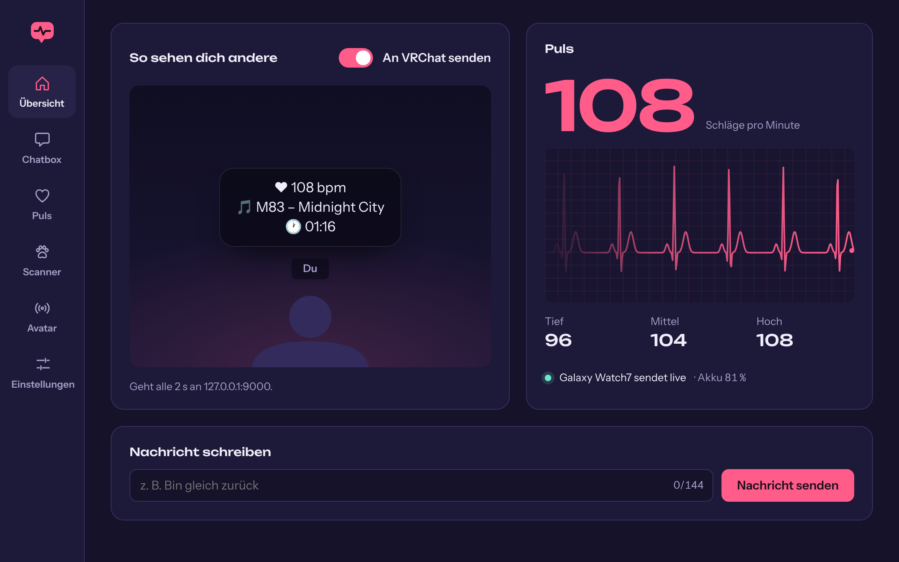

# OSC Tool VRC

Open-Source-Tool für die VRChat-Chatbox: zeigt deinen Live-Puls von der Galaxy
Watch, die laufende Musik, Uhrzeit und eigene Nachrichten über deinem Avatar.
Läuft als Programm unter Windows 10 und 11 sowie unter Linux.

*Open source OSC tool for the VRChat chatbox with live heart rate from a Wear OS
watch. The app itself is available in German and English.*



## Was es kann

- **Chatbox-Vorlage** mit Platzhaltern für Puls, Musik, Uhrzeit, Datum, CPU und
  RAM. Zeilen ohne Inhalt verschwinden von selbst.
- **Live-Puls von der Uhr** über die mitgelieferte Wear-OS-App, direkt per WLAN
  an den PC. Kein Konto, keine Cloud, kein Handy dazwischen.
- **Puls am Avatar** über die Parameter von HRtoVRChat_OSC (`HR`, `HRPercent`,
  `isHRBeat` …), die gängige Puls-Prefabs verstehen.
- **Eigene Nachrichten** tippen und senden, mit Tipp-Anzeige in VRChat.
- **Musik** aus Spotify, Browser und Co. – unter Windows über dessen
  Mediensteuerung, unter Linux über MPRIS (das können praktisch alle Player),
  mit Fortschrittsbalken und auf Wunsch **Songtext live** (von lrclib.net).
- **Furry-Scanner** 🐾: ein Spaß-Scan mit zufälligem Ergebnis in der Chatbox,
  per Knopf oder über einen Parameter am Avatar.
- **Avatar-Parameter senden** (Bool/Int/Float) mit Favoriten, z. B. um
  Kleidung oder Ohren vom PC aus zu schalten.
- **OSC-Monitor**: zeigt live, was VRChat an Port 9001 zurückschickt.
- **Uhr-Infos**: Name, Modell, Wear-OS-Version und Akku der verbundenen Uhr –
  für jede Wear-OS-Uhr, auch ältere oder neuere Modelle.
- **Eigene Nachrichten** bleiben auf Wunsch dauerhaft stehen; zuletzt gesendete
  lassen sich mit einem Klick wiederholen.
- **Aussehen**: Farbschemata Nacht, Dunkel, AMOLED und Hell, freie Akzentfarbe.
- Hält VRChats Chatbox-Limit ein (höchstens ein Update alle 1,5 s, 144 Zeichen,
  9 Zeilen), damit die Chatbox nicht gesperrt wird.

## Easy Anti-Cheat

Das Tool spricht ausschließlich über VRChats offizielle
[OSC-Schnittstelle](https://docs.vrchat.com/docs/osc-overview) mit dem Spiel:
UDP-Pakete an `127.0.0.1:9000` und, wenn du den Empfang einschaltest, zurück
auf Port `9001` – genau dafür hat VRChat sie gebaut. Es liest
keinen Spielspeicher, lädt nichts in das Spiel, legt kein Overlay darüber und
fasst den VRChat-Prozess nicht an – nicht einmal, um zu prüfen, ob er läuft.
Für Easy Anti-Cheat ist es damit ein ganz normales, getrenntes Programm.

## Wie live ist der Puls?

| Strecke | Verzögerung |
| --- | --- |
| Sensor der Uhr | liefert etwa einen Wert pro Sekunde |
| Uhr → PC (WLAN, WebSocket) | wenige Millisekunden |
| PC → Avatar-Parameter | sofort, mit jedem Wert |
| PC → Chatbox | alle 2 s (einstellbar, VRChat erlaubt höchstens alle 1,5 s) |

Am Avatar kommt der Puls also im Sekundentakt an, in der Chatbox alle zwei
Sekunden. Die Uhr selbst glättet ihre Messung über einige Sekunden; schneller
als das geht es mit keinem optischen Sensor.

Dauermessung und WLAN kosten Akku: Rechne auf der Uhr mit deutlich kürzerer
Laufzeit, solange die Übertragung läuft.

## Einrichten

### 1. PC-App

Pakete gibt es auf der [Releases-Seite](../../releases). Solange es noch kein
Release gibt: unter [Actions](../../actions) den neuesten Build öffnen und das
passende Artefakt herunterladen.

**Windows:** Artefakt `osc-tool-vrc-windows`, Installer starten. Fragt Windows
beim ersten Start nach der Firewall, erlaube den Zugriff für private Netzwerke –
sonst erreicht die Uhr den PC nicht.

**Linux:** Artefakt `osc-tool-vrc-linux`. Darin liegen:

- `.deb` für Debian, Ubuntu, Mint, Pop!_OS: `sudo apt install ./OSC*.deb`
- `.rpm` für Fedora, openSUSE: `sudo dnf install ./OSC*.rpm`
- `.AppImage` für alle anderen: `chmod +x OSC*.AppImage`, dann starten.

VRChat läuft unter Linux über Steam/Proton; OSC funktioniert dort genauso.
Ist eine Firewall aktiv (z. B. `ufw` oder `firewalld`), gib TCP-Port `9555`
(Uhr) und UDP-Port `5353` (automatische Suche) im Heimnetz frei.

### 2. VRChat

Im Aktionsmenü (Radialmenü) **Optionen → OSC → Aktiviert** einschalten.

### 3. Watch-App

Die App gibt es nicht im Play Store; sie wird einmalig per ADB installiert.
`app-release.apk` liegt im Release bzw. im Artefakt `osc-tool-vrc-watch`.

1. Auf der Uhr: **Einstellungen → Info zur Uhr → Softwareinformationen**, dort
   siebenmal auf **Softwareversion** tippen. Das schaltet die
   Entwickleroptionen frei.
2. **Einstellungen → Entwickleroptionen → ADB-Debugging** und
   **Drahtloses Debugging** einschalten (die Uhr muss im WLAN sein).
3. In **Drahtloses Debugging** auf **Neues Gerät koppeln** tippen. Die Uhr
   zeigt eine Adresse und einen Code.
4. Am PC mit den
   [Android Platform-Tools](https://developer.android.com/tools/releases/platform-tools):

   ```bash
   adb pair 192.168.1.50:37891
   ```

   ```bash
   adb connect 192.168.1.50:41235
   ```

   ```bash
   adb install app-release.apk
   ```

   Die Adresse für `adb pair` steht im Koppeln-Dialog, die für `adb connect`
   auf der Seite **Drahtloses Debugging** selbst. Die Ports unterscheiden sich.
5. Danach kannst du das Debugging wieder ausschalten.

### 4. Verbinden

Uhr und PC ins selbe WLAN, auf der Uhr **VRC Puls** öffnen und **Start**
tippen. Die Uhr findet den PC selbst. Klappt das in deinem Netz nicht, trägst
du auf der Uhr die Adresse ein, die die PC-App unter **Puls** anzeigt.

Die Uhr misst weiter, wenn das Display aus ist. Zum Beenden **Stopp** tippen.

## Platzhalter

| Platzhalter | Inhalt |
| --- | --- |
| `{hr}` | Puls in Schlägen pro Minute |
| `{hr_trend}` | ↑, ↓ oder → |
| `{heart}` | ❤ und ♡ im Wechsel |
| `{hr_min}` `{hr_max}` `{hr_avg}` | Tiefst-, Höchst- und Mittelwert seit dem Start |
| `{watch}` `{watch_battery}` | Name und Akku der Uhr |
| `{song}` | Interpret – Titel |
| `{title}` `{artist}` `{album}` | Titel, Interpret und Album einzeln |
| `{play}` | ▶ oder ⏸ (pausiert nur sichtbar, wenn „Pausierte Musik weiter anzeigen“ an ist) |
| `{bar}` | Fortschrittsbalken, z. B. `━━━●──────` |
| `{pos}` `{dur}` | Position und Länge des Songs |
| `{lyric}` | Aktuelle Songtext-Zeile. Nur mit diesem Platzhalter fragt die App lrclib.net nach dem Songtext (Interpret und Titel werden dorthin gesendet). |
| `{time}` `{date}` | Uhrzeit und Datum |
| `{cpu}` `{ram}` | Auslastung des PCs |

## Selbst bauen

Voraussetzungen: [Rust](https://rustup.rs), Node.js 22, für die Watch-App
JDK 17 und das Android SDK. Unter Linux zusätzlich die Bibliotheken für Tauri,
etwa unter Debian/Ubuntu:

```bash
sudo apt install libwebkit2gtk-4.1-dev libayatana-appindicator3-dev librsvg2-dev libssl-dev
```

```bash
cd desktop
npm install
npx tauri dev
```

```bash
cd desktop
npx tauri build
```

```bash
cd watch
./gradlew assembleRelease
```

`npm run dev` im Ordner `desktop` startet die Oberfläche allein im Browser, mit
simulierten Daten statt VRChat und Uhr.

Aufbau:

- `desktop/core` – Rust-Bibliothek: OSC, Vorlagen, Puls-Empfänger, Songtexte,
  Furry-Scanner. Tests mit
  `cargo test -p osctool-core`.
- `desktop/src-tauri` – das Programm für Windows und Linux (Tauri).
- `desktop/src` – Oberfläche (Svelte).
- `watch` – Wear-OS-App (Kotlin, Compose).
- [`docs/protocol.md`](docs/protocol.md) – das Protokoll zwischen Uhr und PC,
  falls du eine andere Pulsquelle anbinden willst.

## Lizenz

[MIT](LICENSE)
